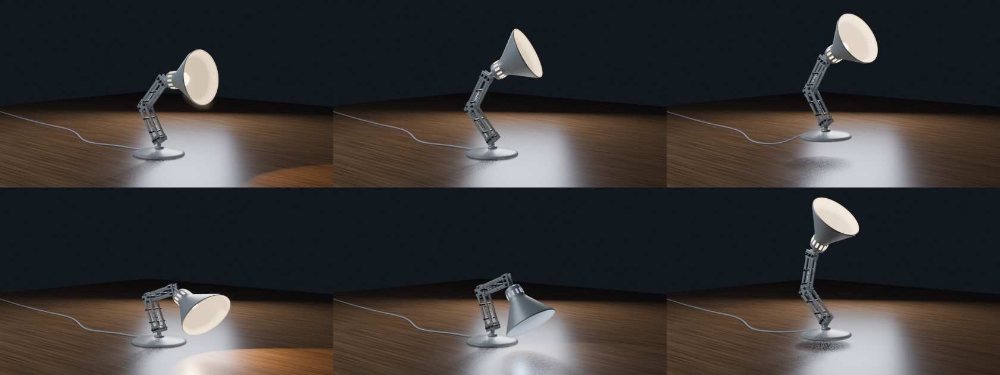
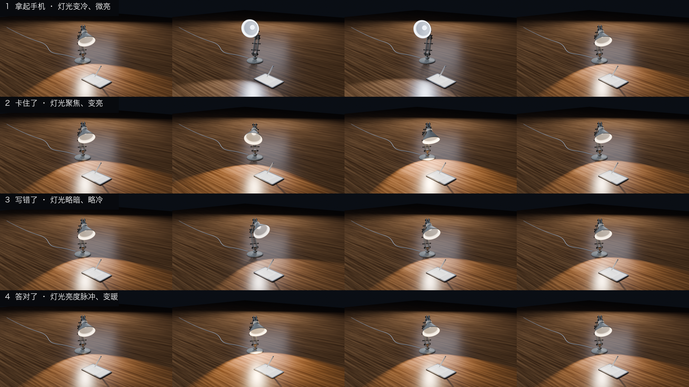
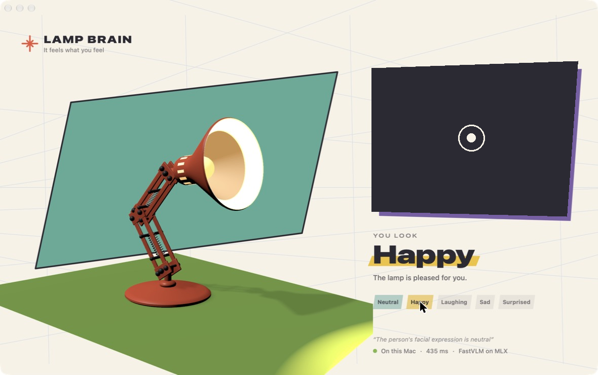

# Lamp Brain

A desk lamp in Blender that mirrors your mood. A webcam frame goes to Apple's
FastVLM running locally through MLX, the model names your expression, and the
lamp plays the matching animation. Nothing leaves the Mac.



```
webcam ──▶ lamp_brain.py (FastVLM on MLX) ──▶ emotion.txt ──▶ lamp_controller.py (Blender)
```

| You | The lamp |
|---|---|
| neutral | breathes, blinks, and now and then looks around or nods at you |
| happy | stands tall and sways, light brightens |
| laughing | hops with squash and stretch, light flickers |
| sad | droops, sighs, shakes its head slowly, light turns dim and cold |
| surprised | flinches back with a flash, then settles |

## lampkit: the study-companion runtime

`lampkit/` is a research prototype for a proactive study companion. Margin supplies learning
signals; optional camera/VLM adapters supply observations. A deterministic estimator, state
machine and policy choose interventions, and a motion generator scores candidate trajectories
using an ELEGNT-inspired F + γE objective. The decision/control loop does not wait for an LLM.

**Verified:** scripted scenarios, deterministic replay, TCP Margin events and returned hint
requests, exam motion cancellation, rejection cooldown, and Blender UDP pose output format.
**Not verified:** live camera/VLM accuracy, real iPad integration, physical motors, or learning
benefits. The native Mac mood demo is separate; it is not yet wired to lampkit. The rendered
behaviour videos are design references, not footage of autonomous real-world perception.

```bash
python -m lampkit simulate scenarios/stuck.json      # stuck → frustrated → hint, printed as a timeline
uv run --no-project --python 3.12 --with pytest pytest -q
```

To watch it drive the Blender lamp, open `design/blender/margin_lamp_behaviours.blend`, run
`blender_live.py` inside Blender, then run
`python -m lampkit simulate scenarios/demo.json --profile twin --realtime`.

- [`docs/INTEGRATION.md`](docs/INTEGRATION.md) gives the live bridge demo, event contract and current limits.
- [`docs/ARCHITECTURE.md`](docs/ARCHITECTURE.md) covers the layers, the state machine, the policy, motion and replay.
- [`design/`](design/README.md) has the proportions, desk renders, the eight reference behaviours (video) and their Blender scripts.



## The Mac app



*The camera panel is blanked out in this screenshot.*

`app/` is a native macOS app that does the whole thing in one window: the lamp
on the left (SceneKit, loading the Blender model as USDZ and the clips as JSON),
your camera on the right, and FastVLM reading your expression on MLX Swift.
Click a mood to preview it without a camera.

It starts from Apple's FastVLM sample app (`app/FastVLM`, `app/Video`, see
`app/LICENSE-APPLE-SAMPLE`); everything under `app/FastVLM App` is new.

```bash
cd app
./get_pretrained_mlx_model.sh --model 1.5b --dest FastVLM/model   # weights are not in this repo
open FastVLM.xcodeproj                                            # set your team, then Run
```

Measured on an M4 Pro with FastVLM-1.5B int8: about 410 ms per reading.

## Run the Blender version

Needs an Apple Silicon Mac, [uv](https://docs.astral.sh/uv/) and Blender 5.x.

**1. Get the model.** Weights are not in this repo. Download Apple's FastVLM-0.5B
and quantize it locally:

```bash
uv sync
uv run mlx_vlm.convert --hf-path apple/FastVLM-0.5B --mlx-path models/FastVLM-0.5B-4bit -q --q-bits 4
```

Then open `models/FastVLM-0.5B-4bit/config.json`, delete the `auto_map` entry,
and delete `llava_qwen.py` from that folder. Otherwise loading tries to run the
repo's PyTorch code instead of mlx-vlm's native processor.

**2. Start the lamp.** Open `lamp.blend`, switch to the Scripting tab, open
`lamp_controller.py` and press Run. The lamp starts idling.

**3. Start the brain.**

```bash
uv run lamp_brain.py --show
```

To see every animation without a camera, run `./demo.sh`.

## Files

| File | What it does |
|---|---|
| `lamp.blend` | The modelled, rigged lamp with all animation clips |
| `lamp_clips.py` | Keyframe tables for the nine clips; run in Blender to rebuild them |
| `lamp_controller.py` | Timer that plays clips, cross-fades, and falls back to idle |
| `lamp_brain.py` | Webcam loop: FastVLM picks one of five words, majority vote, write on change |
| `demo.sh` | Cycles through the emotions |

## Measurements

M4 Pro, 24 GB, one still image, 15 runs, mlx-vlm 0.7.12:

| Model | On disk | Median latency | Peak memory |
|---|---|---|---|
| FastVLM-0.5B, 4-bit | 527 MB | 395 ms | 1.49 GB |
| FastVLM-0.5B, 8-bit | 764 MB | 422 ms | 1.74 GB |

The two are nearly the same speed, so the cost is in the vision encoder
(1024 px input), not the language model.

## Limits

- Expression accuracy on real faces has not been measured yet.
- The lamp model was built interactively; there is no script that regenerates
  the mesh, only the clips.
- FastVLM is released under Apple's research license; check it before any use
  beyond experimenting.

The lamp is an original model in the spirit of classic articulated desk lamps.
The idea of an expressive lamp follows Apple's ELEGNT research.
