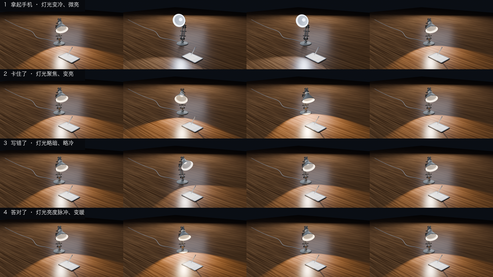
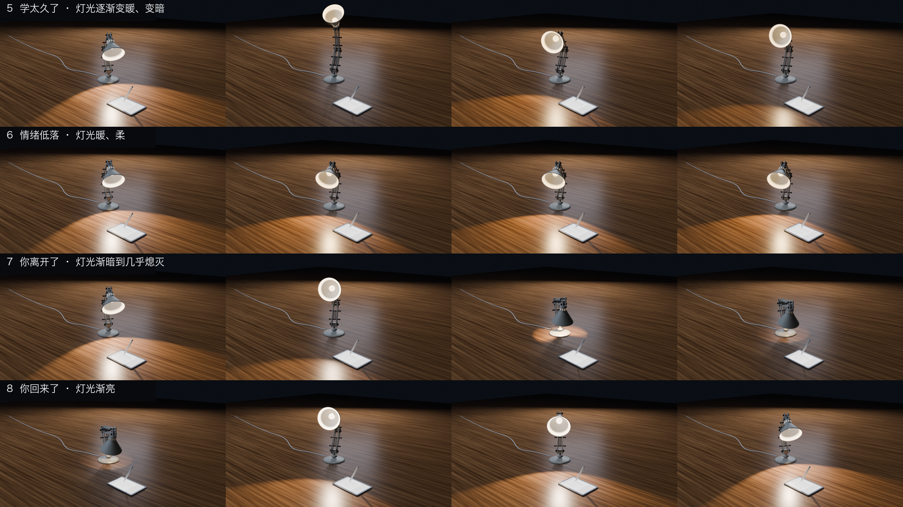
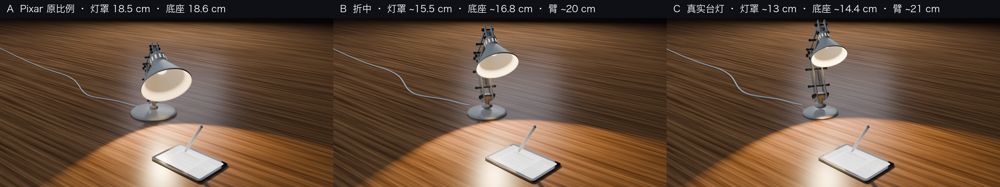
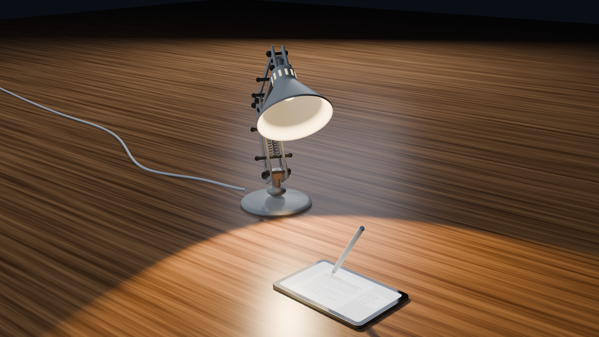

# Design: the Margin lamp

The Margin study lamp, sized for an iPad mini with Apple Pencil. All renders come from Blender 5.2 (Cycles).

`video/margin_lamp_behaviours.mp4` shows all eight behaviours with their light changes: phone
pickup, stuck + hint, wrong answer, correct answer, fatigue → break, comfort, leaving → sleep,
and waking → hello. These are the hand-keyed reference animations. At runtime, `lampkit`
generates its motion live instead (F + γE, see `docs/ARCHITECTURE.md`).

## Proportions

We chose variant B, scaled against the iPad mini's 19.5 cm long edge: shade ≈ 0.75×, base
≈ 0.8×, arms ≈ 1.0×, head height ≈ 1.5×. The lamp sits back-left of the iPad. The pool of light
lands beside the screen rather than on it, and the head dims whenever it turns to look at you.

## Files

| File | What it is |
|---|---|
| `blender/margin_lamp_behaviours.blend` | Scene "Margin Luxo": desk, iPad mini, Pencil, LampRig, the eight `margin_*` actions |
| `blender/margin_ui.py` | Draws the Margin screen texture (Pillow) |
| `blender/margin_desk_scene.py`, `blender/desk_variant_b.py` | Build the desk scene and the variant-B proportions |
| `blender/anim_build.py` | Keys the eight behaviours on LampRig (pose + glow/warmth) |
| `blender/anim_render.py`, `blender/compose.py` | Render the clips and assemble the montage and contact sheets (needs `imageio-ffmpeg`) |

The scripts run through blender-mcp or Blender's Scripting tab, using `/tmp/bl/` as their
scratch folder: the textures, frames and metadata go there.

The centre of the shade is a warm bulb for now. A black orb "face" is a later design pass.
